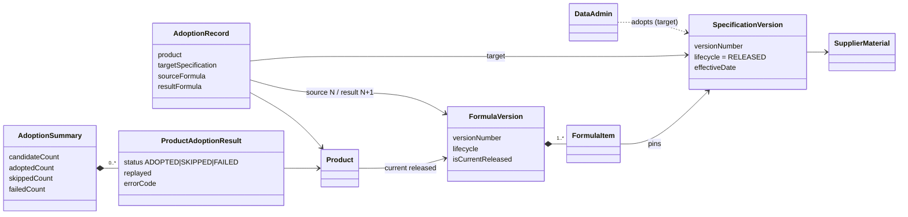
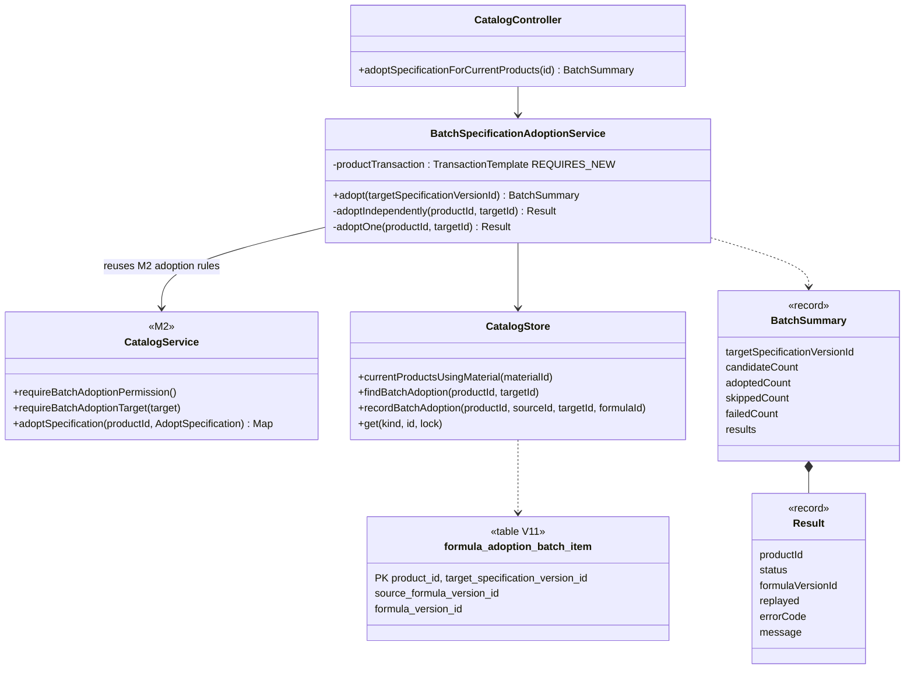
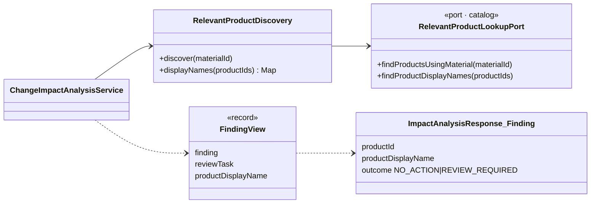

# A07 — M1 use case: Adopt a Released Specification for Current Products

Owner: Huang Xiangjia / M1. Jira: [SCRUM-85](https://hxj04121.atlassian.net/browse/SCRUM-85).
Date: 2026-10-21. Status: **final for SCRUM-85**. It extends the S3
[Run Change Impact Analysis A07](S3-M1-A07-run-change-impact-analysis.md), which this use
case now feeds. The design diagrams use the real class and method names; the analysis
diagram uses domain terms only.

## Why this use case exists

At the Sprint 3 Review (9 Oct) the impact run was demonstrated live, but Spec V2's
FormulaVersion N+1 adoption came from a SQL fixture, and the change request and impact
run were sent by API call because the demo identity switch had no Change Manager or Data
Admin (feedback item 1). Reviewers also found the impact result hard to scan: it showed
product IDs, not names, and had no review-required filter (feedback item 2). This use case
removes the fixture. The impact read-model change below answers item 2 on the backend side.

## Use case

**Actor:** Data Admin (`DATA.MAINTAIN` and `FORMULA.RELEASE`).
**Goal:** adopt one released, effective target specification into a new released
FormulaVersion N+1 for every product whose *current* released formula uses the target's
supplier material, with one request.

**Preconditions:**
- The actor holds both permissions. The service checks this before it reads any product.
- The target specification exists (404 otherwise), is RELEASED and is effective (422 otherwise).

**Main flow:**
1. Select the candidates: products whose current released FormulaVersion has a
   FormulaItem for the target material. Historical formulas never match.
2. For each candidate, in productId order, in its own transaction:
   1. Return the saved result if the product already has a replay marker for this target.
   2. Lock the product and read its current formula again, under the lock.
   3. Run M2's single-product adoption: create, release and audit N+1. N stays RELEASED
      and keeps backing the published label.
   4. Write the `(product, target)` replay marker in the same transaction.
3. Return a summary: candidate, adopted, skipped and failed counts, plus one result per product.

**Postconditions, per product:** either N+1, its audit events and the marker all commit,
or none of them do. One product's failure never rolls back another product.

**Alternate flows:**
- *Replay:* repeating the request returns `ADOPTED` with `replayed=true` and the saved
  `formulaVersionId` for every committed product. No second N+1 is created.
- *Current formula changed after discovery:* the product is adopted from the formula that
  is current under the lock. If that formula no longer uses the material, or already pins
  the target, the product is `SKIPPED` with M2's error code (404, 409 or 422).
- *Concurrent identical request:* the loser fails its lock check, rolls back, re-reads the
  winner's marker and reports `ADOPTED`, `replayed=true`.
- *Unexpected failure* (for example, the marker insert fails): that product is `FAILED`
  and rolled back, with a caller-safe message. The server log keeps the cause. A retry
  adopts it, and the committed products replay.

## Analysis class diagram



## Design class diagram



Impact read model (feedback item 2):



`productDisplayName` is resolved through the existing catalog port when the response is
built. It is not stored on `impact_finding`, so the run's persisted evidence does not
change, and a replayed or re-read run shows the current catalog name. A finding with no
catalog name is a server fault, not a silent fallback to the ID. The review-required
filter uses the existing `outcome` discriminator and the `reviewRequiredCount` counter;
M2's frozen impact contract 1.1.0 adds no query parameter.

## Design sequence diagram: `POST /api/catalog/specifications/{id}/formula-adoptions`

```mermaid
sequenceDiagram
    actor da as Data Admin
    participant web as CatalogController
    participant batch as BatchSpecificationAdoptionService
    participant cat as CatalogService (M2)
    participant store as CatalogStore
    da->>web: POST (no body; identity headers)
    web->>batch: adopt(targetId)
    batch->>cat: requireBatchAdoptionPermission()
    Note right of cat: 403 here: nothing has been read
    batch->>store: get(SPECIFICATION, targetId)
    batch->>cat: requireBatchAdoptionTarget(target)
    batch->>store: currentProductsUsingMaterial(material)
    loop each candidate, by productId
        Note over batch,store: REQUIRES_NEW transaction per product
        batch->>store: findBatchAdoption(product, target)
        alt marker exists
            batch-->>batch: ADOPTED, replayed
        else first adoption
            batch->>store: get(PRODUCT, id, lock)
            batch->>cat: adoptSpecification(product, current N → target)
            cat-->>batch: N+1 (created, released, audited)
            batch->>store: recordBatchAdoption(...)
            batch-->>batch: ADOPTED
        end
        opt the product's transaction rolled back
            batch->>store: findBatchAdoption (winner of a race?)
            batch-->>batch: ADOPTED replayed / SKIPPED / FAILED
        end
    end
    batch-->>web: BatchSummary
    web-->>da: 200 summary
```

## Design problem: one request, many independent atomic adoptions

**Problem.** The demo needs one action that moves 40 products to Spec V2. M2's adoption
rule is atomic per product: N+1, release, audit. A batch must keep that guarantee, must
survive a repeated click or a lost response, and must report one product that no longer
qualifies without discarding the other 39.

**Options considered.**
1. *One transaction for the whole batch.* It is simple. But one late conflict rolls back
   every product, and it holds up to 40 product and material locks at once, which would
   deadlock against ordinary single-product adoptions. Rejected.
2. *Per-product transactions with no stored result.* A replay would re-run adoption and
   hit `SPECIFICATION_ALREADY_ADOPTED`. That reports a success as a skip, and there is no
   saved formula ID to return. Rejected.
3. *Per-product unit of work plus an idempotency key in the same transaction*
   (chosen). Each product is its own Unit of Work (`TransactionTemplate`,
   `REQUIRES_NEW`). The natural key `(product_id, target_specification_version_id)` is the
   primary key of `formula_adoption_batch_item`. It commits together with N+1, so the
   marker exists exactly when the adoption does. The service is the batch's Facade over
   M2's unchanged single-product rule. It does not reimplement any adoption check.

**Consequences.** A replay is a cheap read. A concurrent duplicate is resolved by the
database key and the product lock, not by application timing. A batch can partly succeed,
so the summary always lists every product with its own status, and the HTTP status is 200
once per-product processing has started. Only request-level faults (401, 403, 404, 422,
503 or 500) fail the whole request, as M2's `s4-catalog-batch-adoption-api-v1` contract states.

## Verification links

- [SCRUM-85 evidence](S4-M1-SCRUM-85-demo-adoption-impact.md): demo path, reset steps and test results.
- [S3 Run Change Impact Analysis A07](S3-M1-A07-run-change-impact-analysis.md): the
  downstream use case.
- M2 contracts: [batch adoption](../contracts/s4-catalog-batch-adoption-api-v1.yaml),
  [impact 1.1.0](../contracts/s3-impact-review-publication-api-v1.yaml).
